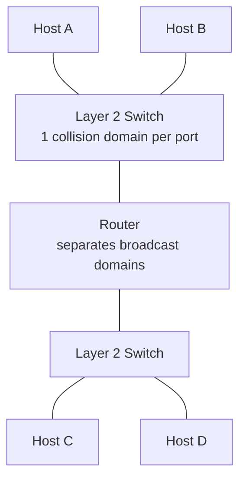
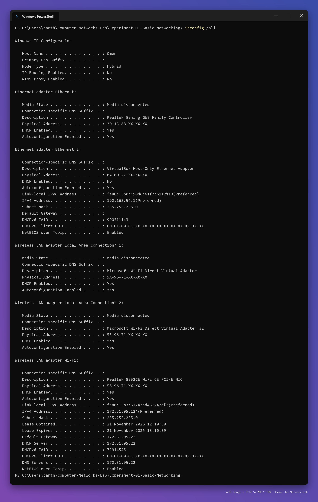
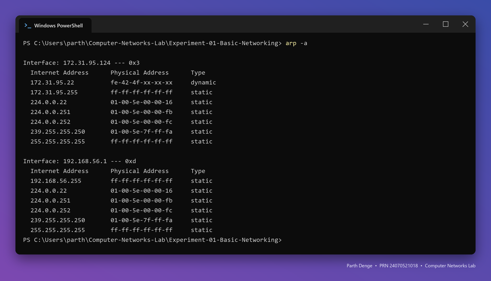
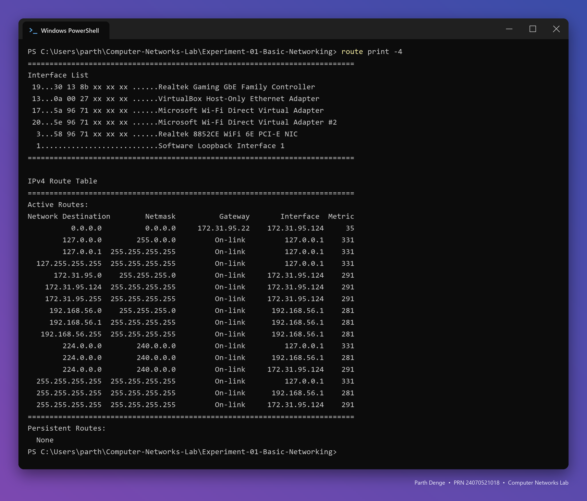

# Experiment 01: Basic Networking Elements and Devices

**Name:** Parth Denge  **PRN:** 24070521018

## 1. Aim
To study the basic building blocks of a computer network (network types, topologies, transmission media and connecting devices such as repeaters, hubs, bridges, switches, routers, gateways, modems and NICs), and to inspect the network configuration of a real host with `ipconfig`, `arp` and `route`.

---

## 2. Theory

A **computer network** is a set of autonomous devices that exchange data over a transmission medium using agreed protocols. Each connecting device works at a particular layer of the OSI model.

### 2.1 Network types and topologies
- **LAN:** a room, lab or building; Ethernet / Wi-Fi; high speed, low latency.
- **MAN:** a city or campus.
- **WAN:** countries or continents; joins many LANs through routers (the Internet).
- **Topologies:** Bus, Star, Ring, Mesh and Hybrid. Modern Ethernet LANs use an extended star built around switches.

### 2.2 Transmission media
- **Guided:** twisted pair (Cat5e / Cat6 with RJ-45 connectors), coaxial cable, optical fibre.
- **Unguided:** radio (Wi-Fi, cellular), microwave, infrared.

### 2.3 Connecting devices

| Device | OSI layer | Works on | Collision domains | Broadcast domains | How it forwards |
| ------ | --------- | -------- | ----------------- | ----------------- | --------------- |
| **Repeater** | 1 Physical | bits | 1 (shared) | 1 | regenerates the signal |
| **Hub** | 1 Physical | bits | 1 shared by all ports | 1 | floods every frame out of all ports |
| **Bridge** | 2 Data Link | MAC address | 1 per segment | 1 | learns MACs, filters / forwards between 2 segments |
| **Switch** | 2 Data Link | MAC address | 1 per port | 1 (unless VLANs) | MAC (CAM) table lookup, full duplex |
| **Router** | 3 Network | IP address | 1 per interface | 1 per interface | routing table lookup, blocks broadcasts |
| **Gateway** | 4 – 7 | application data | — | — | protocol translation between unlike networks |
| **Modem** | 1 Physical | signals | — | — | modulates / demodulates digital ↔ analog |
| **NIC** | 1 – 2 | MAC address | — | — | connects a host to the medium; holds the 48-bit MAC |

### 2.4 Collision domain vs broadcast domain
- A **collision domain** is a segment where two simultaneous transmissions collide. A hub has one for all ports; a switch has one **per port**.
- A **broadcast domain** is the set of hosts that receive a broadcast frame. Hubs and switches pass broadcasts; **routers stop them**, so every router interface is its own broadcast domain.

---

## 3. Procedure
1. Open PowerShell (or Command Prompt) on the lab machine.
2. Run `ipconfig /all` to list every network adapter (NIC), its MAC address, IP address, subnet mask, default gateway, DHCP and DNS servers.
3. Run `arp -a` to see the ARP cache: the IP → MAC mappings learned on the local network.
4. Run `route print -4` to see the IPv4 routing table and the default route.
5. Relate each output to the devices studied above.

---

## 4. Output Screenshots

> MAC addresses and DHCP client IDs are partly masked (`XX`) for privacy. Everything else is the real output.

**`ipconfig /all`**: adapters, MAC (physical) addresses, IP configuration

**`arp -a`**: IP to MAC mapping (data-link layer)

**`route print -4`**: routing table (network layer)

---

## 5. Observations

| Observation from the screenshots | Device / concept it shows |
| -------------------------------- | ------------------------- |
| The laptop has several **NICs**: a Realtek Gigabit Ethernet controller, a Realtek Wi-Fi 6E card, two Wi-Fi Direct virtual adapters and a VirtualBox host-only adapter. Each has its own 48-bit **physical (MAC) address**. | NIC, MAC addressing (Layer 2) |
| The Wi-Fi adapter got **172.31.95.124 / 255.255.255.0** from a **DHCP server** at 172.31.95.22. | Logical (IP) addressing (Layer 3) |
| 172.31.95.22 is at the same time the **default gateway**, the **DHCP server** and the **DNS server**: a home / hotspot router combines router, switch and server roles in one box. | Router, gateway |
| `arp -a` maps 172.31.95.22 to a MAC address: frames to the gateway are sent to that MAC, while the IP header still carries the final destination. | ARP links Layer 3 to Layer 2 |
| Entries for `x.x.x.255` and `255.255.255.255` map to `ff-ff-ff-ff-ff-ff`, and `224.x / 239.x` multicast groups map to `01-00-5e-…` MACs. | Broadcast and multicast addresses |
| In `route print`, the route `0.0.0.0 / 0.0.0.0 → 172.31.95.22` is the **default route**: anything not on a local subnet goes to the router. Local subnets (172.31.95.0/24, 192.168.56.0/24) are **On-link**. | Routing table, router's job |
| The VirtualBox host-only adapter (192.168.56.1/24) is a separate subnet with no gateway: a separate broadcast domain on the same PC. | Broadcast domains, virtual NIC |

---

## 6. Result
The basic networking elements, transmission media and connecting devices were studied along with their OSI layers and their effect on collision and broadcast domains. The configuration of a real host was inspected with `ipconfig /all`, `arp -a` and `route print`, which showed the NICs and their MAC addresses, IP addressing through DHCP, the ARP mapping from IP to MAC, and the default route through the router.
