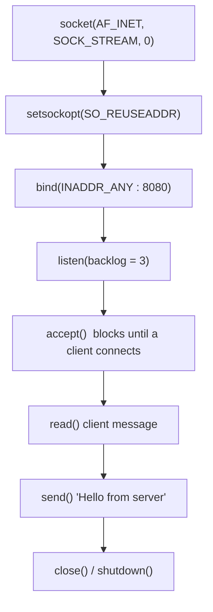
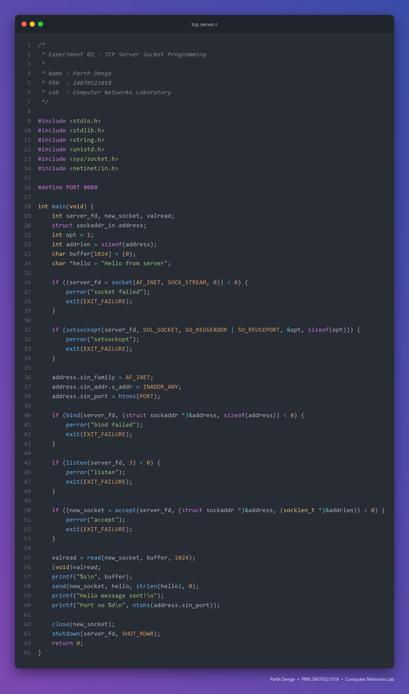
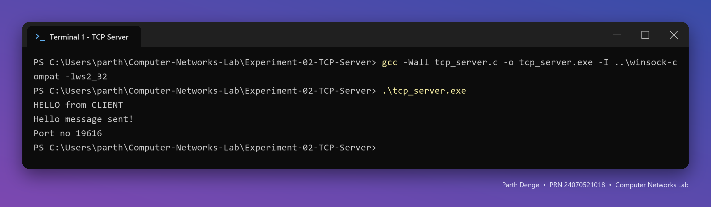
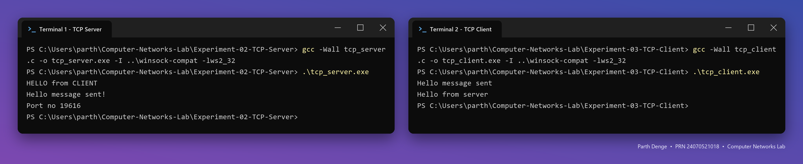

# Experiment 02: TCP Server Socket Programming

**Name:** Parth Denge  **PRN:** 24070521018

## 1. Aim
To implement a connection-oriented **TCP server** in C using the Berkeley socket API: create a stream socket, bind it to port `8080`, listen, accept a client connection, receive a message, send a reply and close the connection.

---

## 2. Theory

**TCP (Transmission Control Protocol)** is a transport-layer protocol that gives reliable, ordered, error-checked delivery of a byte stream.

- **Connection-oriented:** a three-way handshake (`SYN → SYN+ACK → ACK`) sets up the connection before any data is sent.
- **Reliable:** sequence numbers, acknowledgements and retransmission timers recover lost segments.
- **Flow control:** the receiver advertises a window so the sender cannot overrun it.
- **Congestion control:** slow start, congestion avoidance, fast retransmit and fast recovery.

### 2.1 Server socket life cycle



### 2.2 System calls used

| Call | Purpose |
| ---- | ------- |
| `socket(AF_INET, SOCK_STREAM, 0)` | create an IPv4 TCP socket |
| `setsockopt(..., SO_REUSEADDR, ...)` | allow the port to be reused immediately (no wait for `TIME_WAIT`) |
| `bind()` | attach the socket to IP `INADDR_ANY` (all interfaces) and port 8080 |
| `listen(fd, 3)` | make it a passive socket with a queue of up to 3 pending connections |
| `accept()` | take the first connection from the queue and return a **new** socket for it |
| `read()` / `send()` | receive and send data on the connected socket |
| `close()` / `shutdown()` | release the connection (TCP sends FIN) |
| `htons()` / `ntohs()` | convert the port between host and network byte order |

---

## 3. Algorithm
1. Create a TCP socket with `socket()`; on failure print the error and exit.
2. Set `SO_REUSEADDR` (and `SO_REUSEPORT` on Linux) with `setsockopt()`.
3. Fill `struct sockaddr_in`: family `AF_INET`, address `INADDR_ANY`, port `htons(8080)`.
4. `bind()` the socket, then `listen()` with a backlog of 3.
5. `accept()` blocks until a client connects and returns a new socket descriptor.
6. `read()` the client's message into a buffer and print it.
7. `send()` the reply `"Hello from server"` and print `Hello message sent!`.
8. Print the client's port number, `ntohs(address.sin_port)`, which `accept()` filled in.
9. Close the connected socket and shut down the listening socket.

---

## 4. Program
Source: [`tcp_server.c`](tcp_server.c)



---

## 5. How to Run

Start the **server first**, then run the client from [Experiment 03](../Experiment-03-TCP-Client) in a second terminal.

```bash
# Linux / WSL
gcc tcp_server.c -o tcp_server
./tcp_server
```

```powershell
# Windows (MinGW)
gcc -Wall tcp_server.c -o tcp_server.exe -I ..\winsock-compat -lws2_32
.\tcp_server.exe
```

---

## 6. Output

**Server terminal**



**Server and client side by side**



### Observations
- `accept()` blocked until the client connected; then the server printed the client's message **`HELLO from CLIENT`**.
- After replying it printed `Hello message sent!`.
- `Port no 19616` is the **client's ephemeral port**, chosen by the OS. The server itself listens on 8080. This number changes on every run.
- The program compiled with `-Wall` without a single warning.

---

## 7. Result
A connection-oriented TCP server was implemented in C. It created a stream socket, bound to port 8080, listened, accepted a client connection, exchanged messages over the established connection and closed it cleanly.
