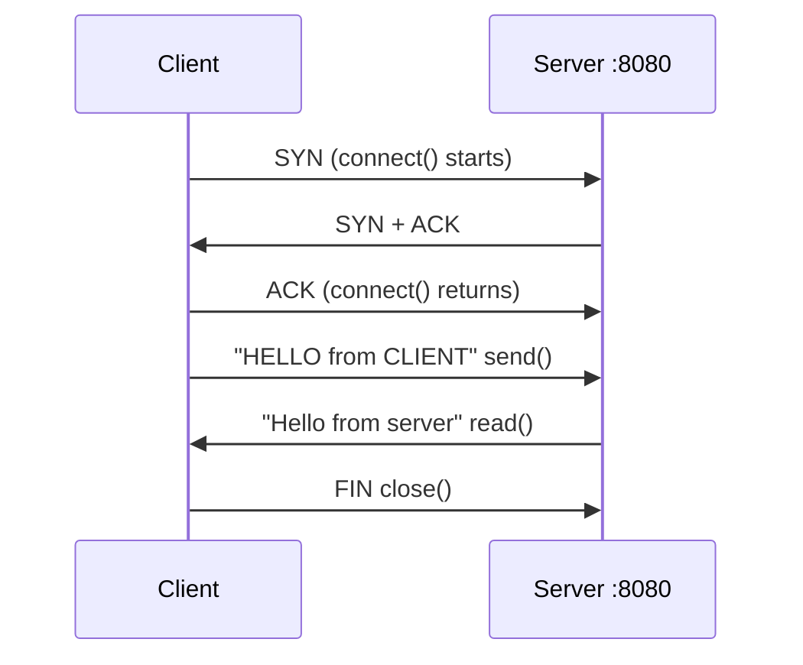
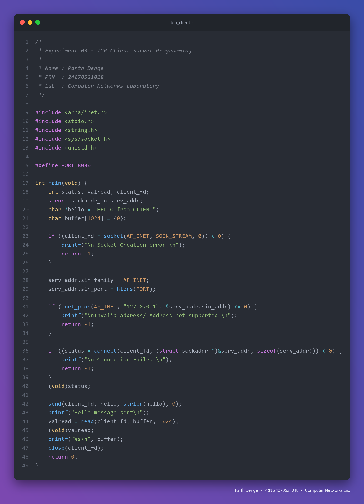
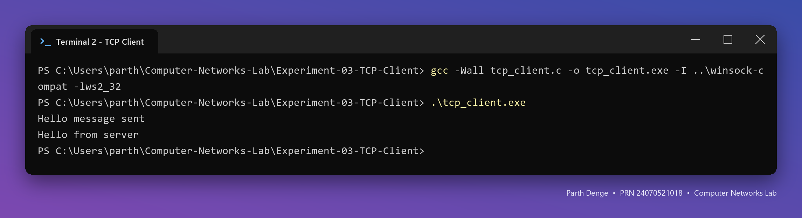
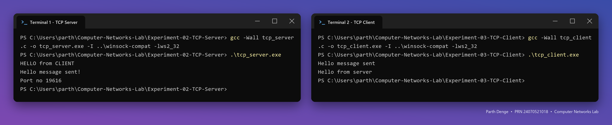

# Experiment 03: TCP Client Socket Programming

**Name:** Parth Denge  **PRN:** 24070521018

## 1. Aim
To implement a **TCP client** in C that connects to the TCP server of Experiment 02 at `127.0.0.1:8080`, sends a message, receives the server's reply and closes the connection.

---

## 2. Theory

The client is the **active** side of a TCP connection. It does not `bind()` or `listen()`: the operating system gives it a temporary (ephemeral) port automatically, and `connect()` starts the three-way handshake.



| Call | Purpose |
| ---- | ------- |
| `socket(AF_INET, SOCK_STREAM, 0)` | create a TCP socket |
| `inet_pton(AF_INET, "127.0.0.1", ...)` | convert the dotted IP string into binary network form |
| `connect()` | perform the three-way handshake with the server |
| `send()` / `read()` | exchange data over the connection |
| `close()` | end the connection |

**Loopback (`127.0.0.1`)** is a virtual interface inside the host; packets never leave the machine, so the client and server can run on the same PC.

---

## 3. Algorithm
1. Create a TCP socket; on failure print `Socket Creation error`.
2. Fill `struct sockaddr_in` with `AF_INET` and port `htons(8080)`.
3. Convert `"127.0.0.1"` with `inet_pton()`; on failure print `Invalid address`.
4. `connect()` to the server; on failure print `Connection Failed`.
5. `send()` the message `"HELLO from CLIENT"` and print `Hello message sent`.
6. `read()` the reply and print it.
7. `close()` the socket.

---

## 4. Program
Source: [`tcp_client.c`](tcp_client.c)



---

## 5. How to Run

Run the server from [Experiment 02](../Experiment-02-TCP-Server) first, then:

```bash
# Linux / WSL
gcc tcp_client.c -o tcp_client
./tcp_client
```

```powershell
# Windows (MinGW)
gcc -Wall tcp_client.c -o tcp_client.exe -I ..\winsock-compat -lws2_32
.\tcp_client.exe
```

If the server is not running, `connect()` fails and the client prints `Connection Failed`.

---

## 6. Output

**Client terminal**



**Both terminals of the session**



### Observations
- The client printed `Hello message sent` after `send()`, then the server's reply **`Hello from server`**.
- On the server side the message arrived as `HELLO from CLIENT`, and the server reported the client's ephemeral port.
- The whole exchange went over the loopback interface; no physical network was needed.

---

## 7. Result
A TCP client was implemented in C. It connected to the server on `127.0.0.1:8080`, completed the handshake, sent a message, received the reply and closed the connection, showing reliable connection-oriented communication between two processes.
