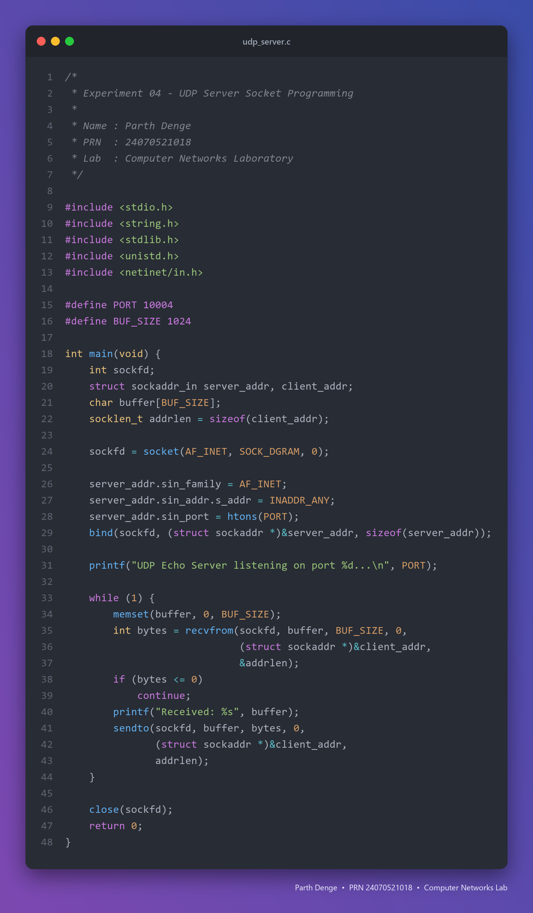
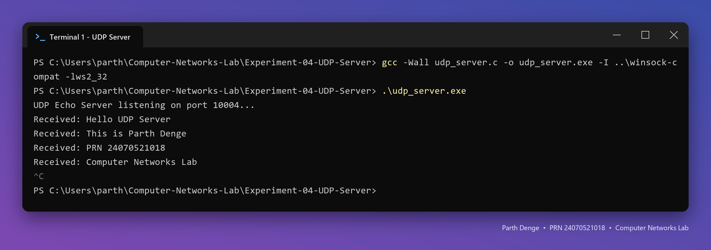
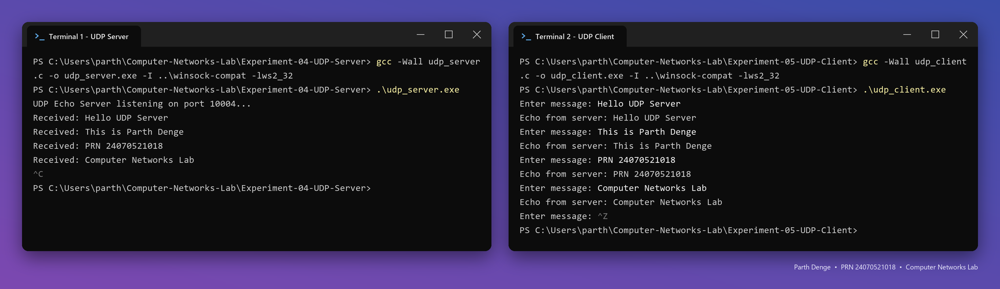

# Experiment 04: UDP Server Socket Programming

**Name:** Parth Denge  **PRN:** 24070521018

## 1. Aim
To implement a connectionless **UDP echo server** in C that binds to port `10004`, receives datagrams with `recvfrom()` and sends each one back to its sender with `sendto()`.

## 2. Theory
**UDP (User Datagram Protocol)** is a connectionless transport protocol: no handshake, no acknowledgements, no retransmission and no ordering. Each datagram is independent and carries its own destination address. It has very little overhead (8-byte header), which suits DNS, streaming, VoIP and gaming.

| | TCP | UDP |
|---|---|---|
| Connection | handshake first | none |
| Reliability | ACKs + retransmission | best effort |
| Ordering | guaranteed | not guaranteed |
| Server calls | `socket, bind, listen, accept, read, send` | `socket, bind, recvfrom, sendto` |
| Header | 20+ bytes | 8 bytes |

Because there is no connection, the server learns **who** sent each datagram from the address that `recvfrom()` fills in, and uses that address in `sendto()` for the reply.

## 3. Algorithm
1. Create a socket with `socket(AF_INET, SOCK_DGRAM, 0)`.
2. Bind it to `INADDR_ANY` and port `htons(10004)`.
3. Print `UDP Echo Server listening on port 10004...`.
4. Loop forever: clear the buffer, `recvfrom()` a datagram (this also gives the client address), print it, and `sendto()` the same bytes back to that address.
5. Stop with `Ctrl + C`.

## 4. Program
Source: [`udp_server.c`](udp_server.c)



## 5. How to Run
```bash
gcc udp_server.c -o udp_server && ./udp_server                              # Linux / WSL
```
```powershell
gcc -Wall udp_server.c -o udp_server.exe -I ..\winsock-compat -lws2_32      # Windows
.\udp_server.exe
```
Then run the client from [Experiment 05](../Experiment-05-UDP-Client) in another terminal.

## 6. Output

**Server terminal**



**Server and client side by side**



### Observations
- The server printed every datagram it received (`Received: ...`) and echoed it back; the client showed the same text as `Echo from server: ...`.
- No connection was set up: the server never called `listen()` or `accept()`, and one socket served all datagrams.
- The server keeps running after the client exits and has to be stopped with `Ctrl + C`.

## 7. Result
A UDP echo server was implemented in C. It received independent datagrams with `recvfrom()` and replied to each sender with `sendto()`, demonstrating connectionless communication.
