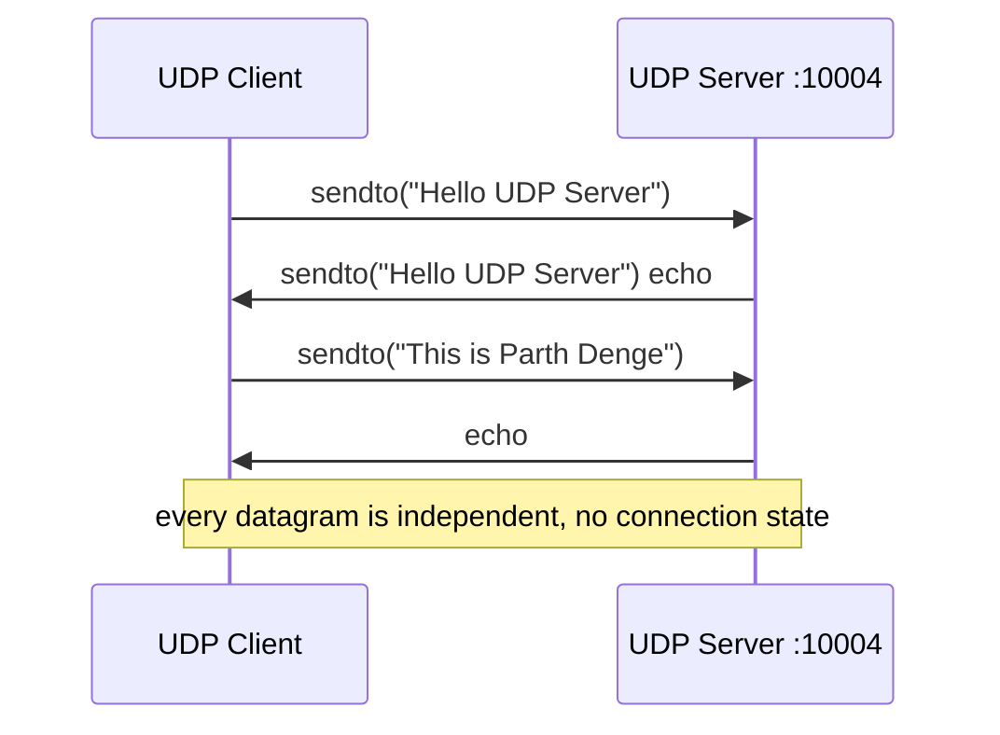
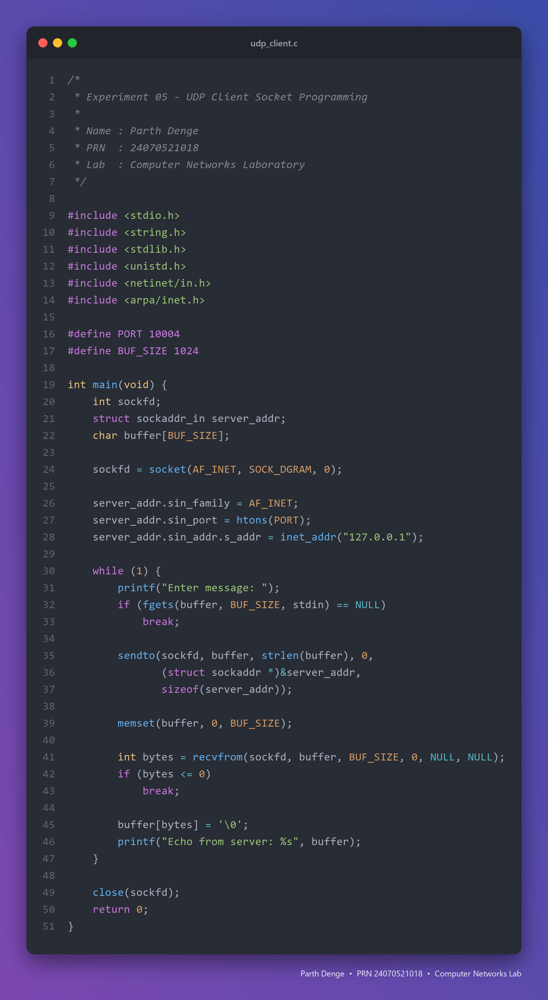
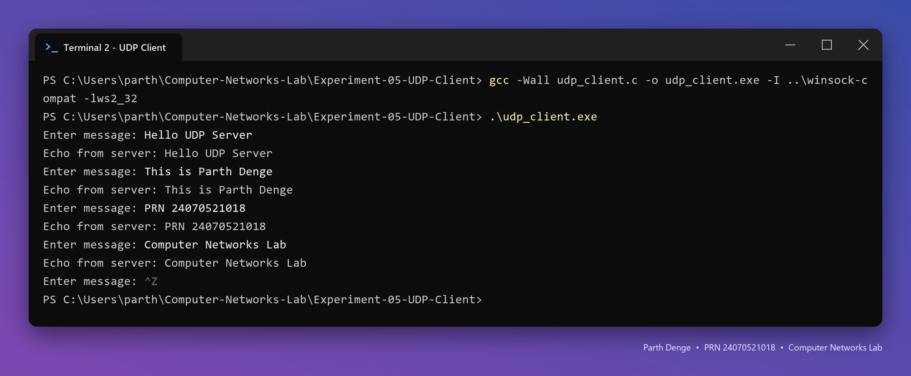
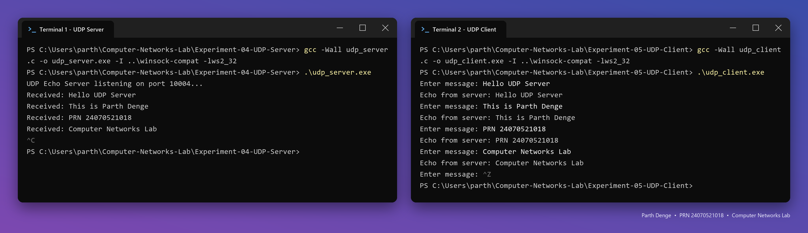

# Experiment 05: UDP Client Socket Programming

**Name:** Parth Denge  **PRN:** 24070521018

## 1. Aim
To implement a **UDP client** in C that reads messages from the keyboard, sends each one as a datagram to the echo server at `127.0.0.1:10004` and prints the echoed reply.

## 2. Theory
A UDP client needs no `connect()` and no handshake: it puts the server's address in every `sendto()` call. The OS assigns the client an ephemeral port on the first send, and the server replies to that port. If a datagram is lost, UDP does nothing about it; the application would have to handle a timeout itself.



## 3. Algorithm
1. Create a socket with `socket(AF_INET, SOCK_DGRAM, 0)`.
2. Fill the server address: `AF_INET`, port `10004`, IP `inet_addr("127.0.0.1")`.
3. Loop: print `Enter message: ` and read a line with `fgets()` (stop at end of input).
4. `sendto()` the line to the server.
5. `recvfrom()` the reply, terminate it with `'\0'` and print `Echo from server: ...`.
6. Close the socket when input ends (`Ctrl + Z` + Enter on Windows, `Ctrl + D` on Linux).

## 4. Program
Source: [`udp_client.c`](udp_client.c)



## 5. How to Run
Start the server from [Experiment 04](../Experiment-04-UDP-Server) first.
```bash
gcc udp_client.c -o udp_client && ./udp_client                              # Linux / WSL
```
```powershell
gcc -Wall udp_client.c -o udp_client.exe -I ..\winsock-compat -lws2_32      # Windows
.\udp_client.exe
```

## 6. Output

**Client terminal** (messages typed: `Hello UDP Server`, `This is Parth Denge`, `PRN 24070521018`, `Computer Networks Lab`)



**Both terminals**



### Observations
- Every message typed came straight back from the server as `Echo from server: ...`.
- The server window shows the same four messages as `Received: ...`.
- Ending the input (`^Z`) closed the client while the server kept running, because UDP keeps no connection between them.

## 7. Result
A UDP client was implemented in C. It sent user messages as independent datagrams with `sendto()` and received the echoes with `recvfrom()`, completing connectionless client-server communication with the server of Experiment 04.
