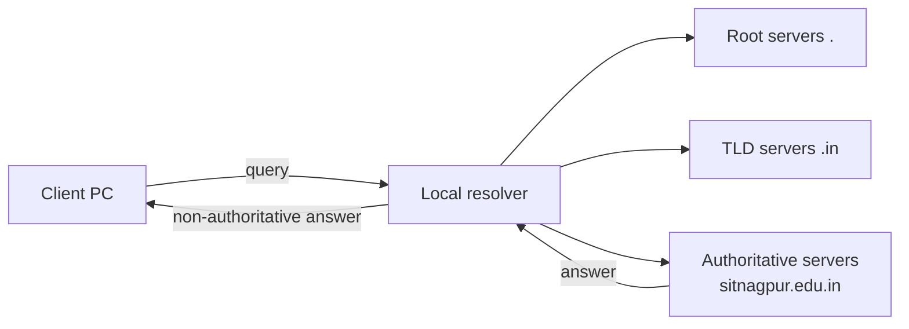
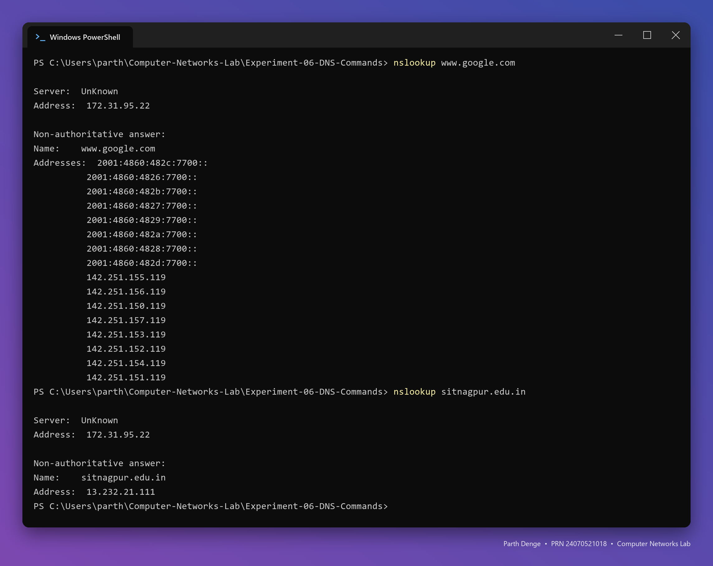
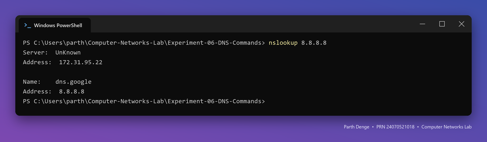
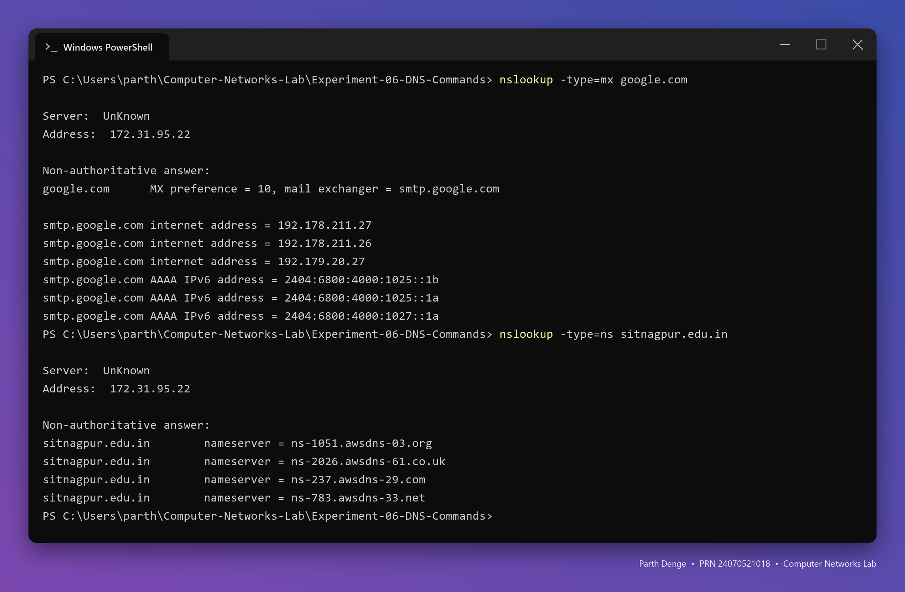
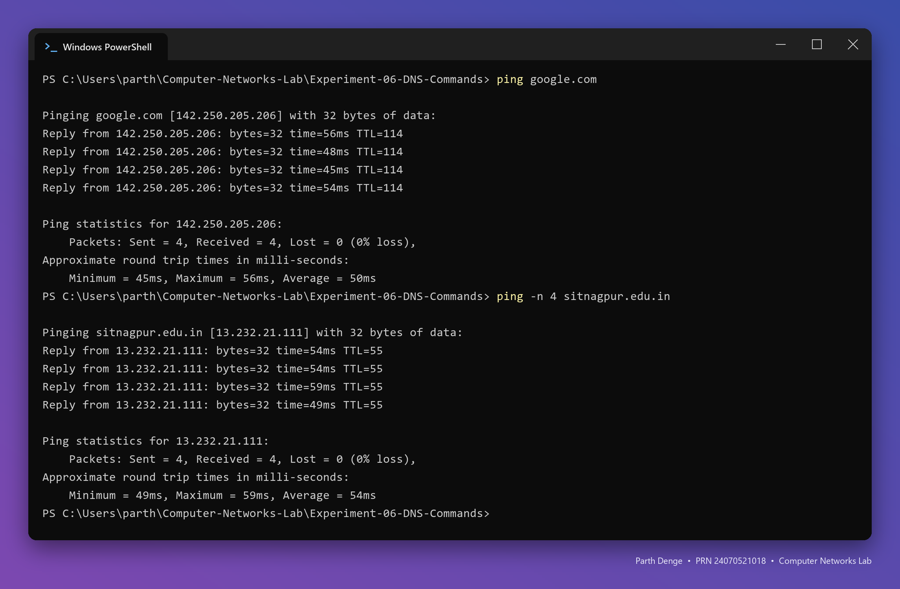
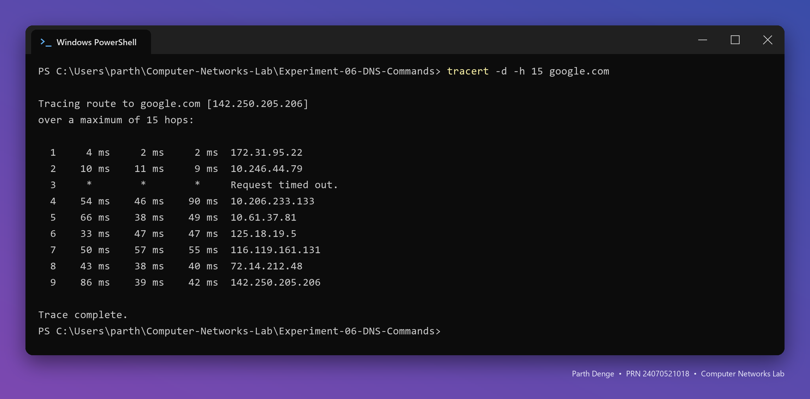
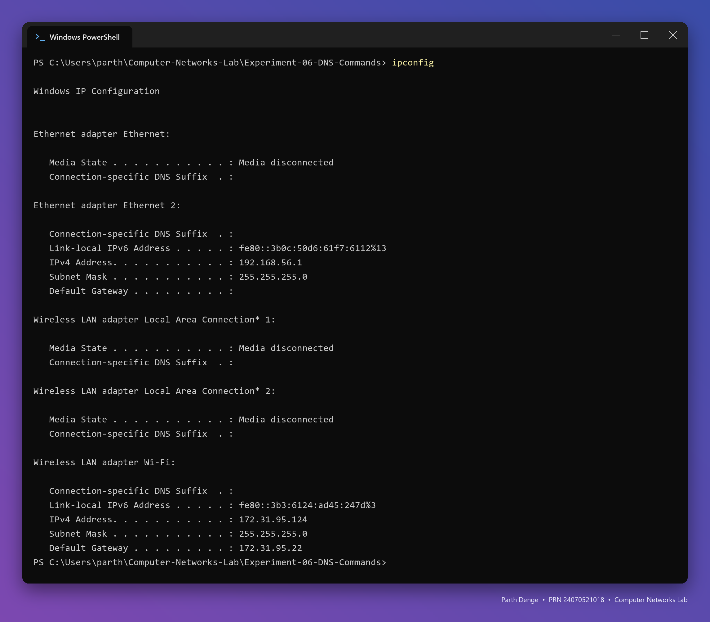

# Experiment 06: DNS Commands Using the Terminal

**Name:** Parth Denge  **PRN:** 24070521018

## 1. Aim
To study the Domain Name System and use terminal diagnostic commands (`nslookup`, `ping`, `tracert`, `ipconfig`) for forward and reverse DNS lookups, DNS record queries, ICMP reachability tests and route tracing.

## 2. Theory
**DNS** is a hierarchical, distributed database that maps names such as `www.google.com` to IP addresses. A client asks its **local resolver**, which queries the **root**, **TLD** (`.in`, `.com`) and **authoritative** servers on its behalf and caches the answer for the record's TTL.

| Record | Meaning |
|---|---|
| **A / AAAA** | name → IPv4 / IPv6 address |
| **CNAME** | alias → canonical name |
| **PTR** | IP → name (reverse lookup, `in-addr.arpa`) |
| **MX** | mail server for the domain, with preference |
| **NS** | authoritative name servers for the zone |

| Command | Protocol | Layer | Use |
|---|---|---|---|
| `nslookup` | DNS (UDP/TCP 53) | Application | forward / reverse lookups, record types |
| `ping` | ICMP Echo Request (8) / Reply (0) | Network | reachability, round-trip time, packet loss |
| `tracert` | ICMP with increasing TTL, Time Exceeded (11) | Network | list the routers on the path |
| `ipconfig` | local TCP/IP stack | Network | IP, mask, gateway; `/all`, `/displaydns`, `/flushdns` |

## 3. Procedure
1. `nslookup www.google.com` and `nslookup sitnagpur.edu.in`: forward lookups.
2. `nslookup 8.8.8.8`: reverse (PTR) lookup.
3. `nslookup -type=mx google.com` and `nslookup -type=ns sitnagpur.edu.in`: other record types.
4. `ping google.com` and `ping -n 4 sitnagpur.edu.in`: ICMP echo.
5. `tracert -d -h 15 google.com`: route tracing (`-d` skips reverse lookups, `-h` limits the hops).
6. `ipconfig`: the local IP configuration used for all of the above.

## 4. Output Screenshots

**Forward lookup**

**Reverse lookup (PTR)**

**MX and NS records**

**ping**

**tracert**

**ipconfig**

## 5. Observations
- Every answer came from the local resolver **172.31.95.22** (shown as `UnKnown` because the resolver itself has no PTR name) and was marked **Non-authoritative**: it came from a resolver or cache, not from the domain's own servers.
- `www.google.com` returned **8 IPv6 and 8 IPv4 addresses**: Google spreads load over many servers (DNS load balancing).
- `sitnagpur.edu.in` resolved to **13.232.21.111**, and its **NS** records are `awsdns` servers, so the domain is hosted on Amazon Route 53 / AWS.
- The reverse lookup of **8.8.8.8** gave the PTR name **`dns.google`**.
- The **MX** record shows that mail for `google.com` goes to `smtp.google.com` with preference 10.
- `ping` got 4/4 replies with **0% loss**; average RTT was **50 ms** to google.com and **54 ms** to sitnagpur.edu.in.
- `tracert` reached Google in **9 hops**. Hop 1 is the local gateway, hops 2–5 are private `10.x` addresses inside the ISP, and hop 3 shows `* * *` because that router does not answer ICMP.

## 6. Result
Forward and reverse DNS resolution, MX/NS record lookups, ICMP reachability with `ping`, hop-by-hop route tracing with `tracert` and the local IP configuration with `ipconfig` were all demonstrated and explained.
