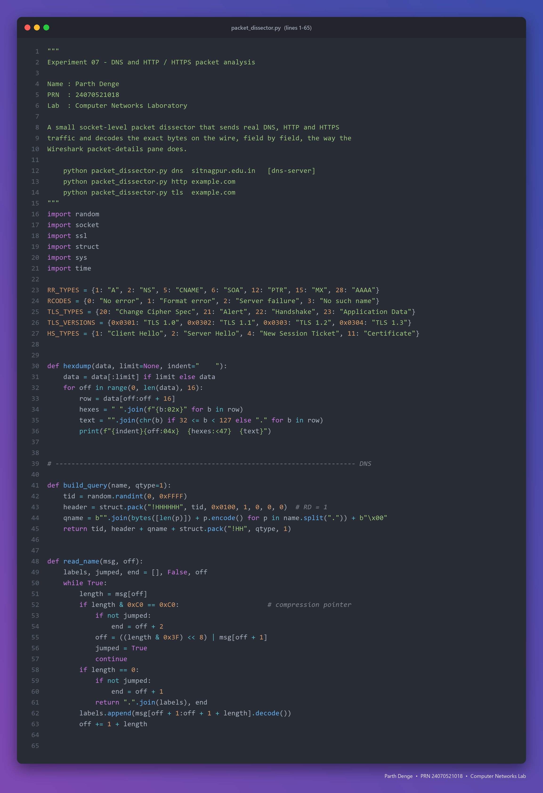
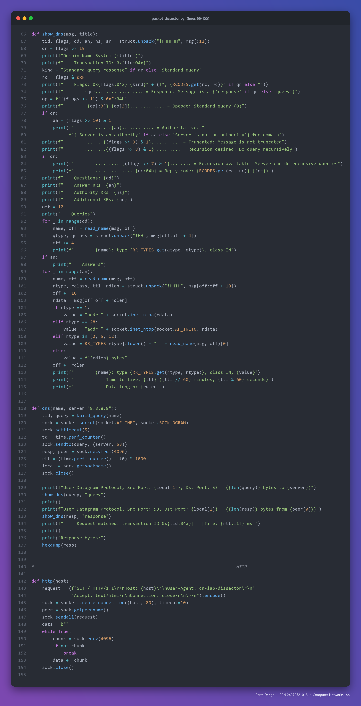
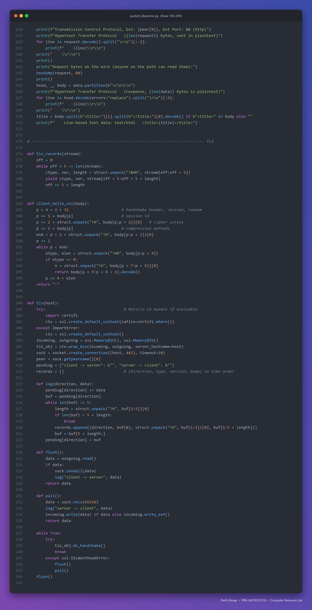
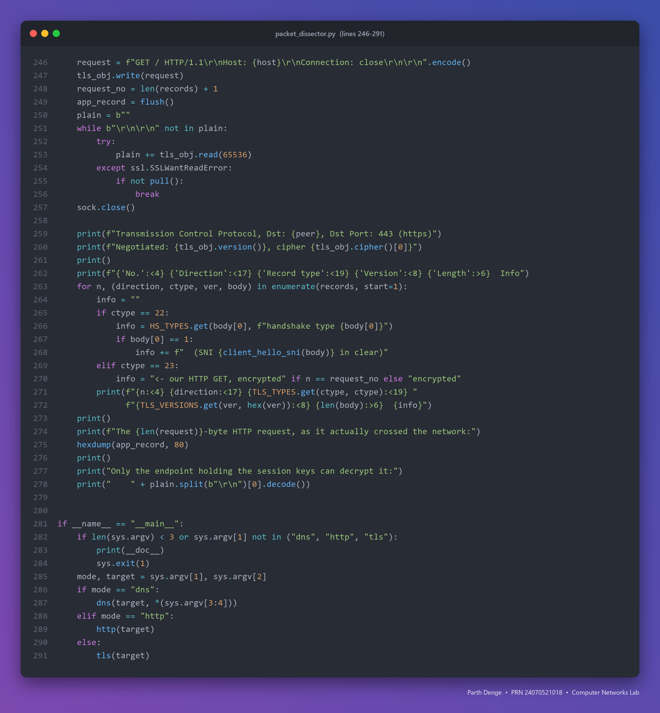
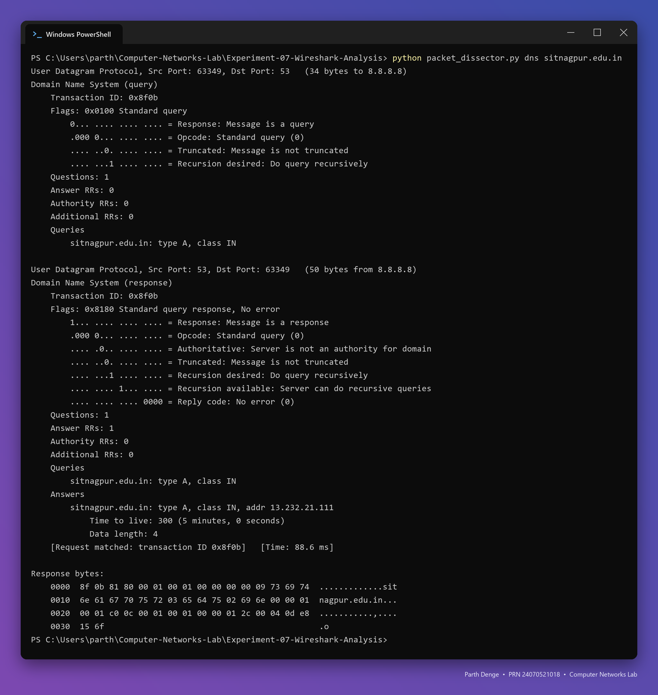
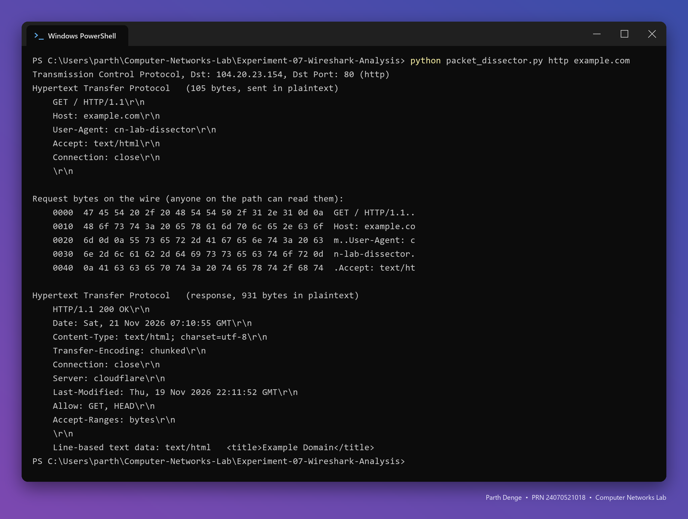
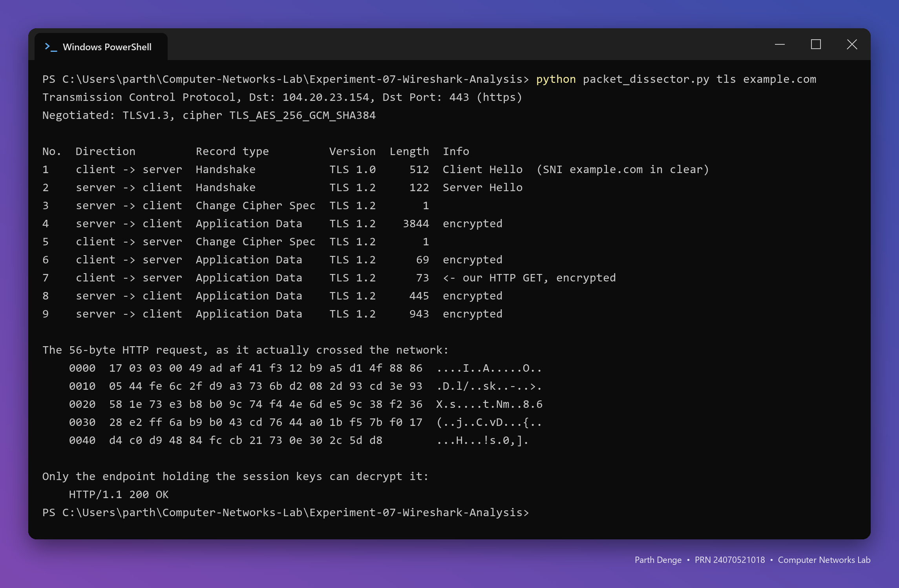

# Experiment 07: DNS and HTTP / HTTPS Packet Analysis

**Name:** Parth Denge  **PRN:** 24070521018

## 1. Aim
To analyse the structure of **DNS** messages and compare plaintext **HTTP** with encrypted **HTTPS (TLS)** traffic by decoding real packets field by field, as the Wireshark packet-details pane does.

## 2. Theory

### 2.1 Encapsulation
```text
Ethernet II (MAC) | IPv4 (IP addresses) | UDP 53 / TCP 80 / TCP 443 | DNS / HTTP / TLS
```

### 2.2 DNS message (UDP port 53)
| Field | Size | Meaning |
|---|---|---|
| Transaction ID | 16 bits | matches a response to its query |
| Flags | 16 bits | QR (query/response), Opcode, AA, TC, RD, RA, RCODE |
| QDCOUNT / ANCOUNT / NSCOUNT / ARCOUNT | 16 bits each | number of questions, answers, authority and additional records |
| Questions | variable | name, type (A, AAAA, ...), class (IN) |
| Answers | variable | name, type, class, **TTL**, data length, data (e.g. IP address) |

Names are stored as length-prefixed labels (`09 sitnagpur 03 edu 02 in 00`). In answers, a name may be replaced by a 2-byte **compression pointer** (`c0 0c` = "the name at offset 12").

### 2.3 HTTP vs HTTPS
| | HTTP | HTTPS (TLS) |
|---|---|---|
| Port | 80 | 443 |
| Wireshark filter | `http` | `tls` or `tcp.port == 443` (`https` is not a valid filter) |
| Visible on the wire | request line, headers, body | only the handshake metadata (e.g. SNI host name) |
| Confidentiality / integrity | none | AES-GCM / ChaCha20-Poly1305 encryption with authentication tags |
| Server authentication | none | X.509 certificate |

## 3. Tool Used
Wireshark (with Npcap) needs administrator rights to capture, and it was **not installed** on the machine used for these screenshots. I wrote [`packet_dissector.py`](packet_dissector.py) instead. It sends **real** traffic and decodes the **actual bytes** sent and received:

| Command | What it does |
|---|---|
| `python packet_dissector.py dns sitnagpur.edu.in` | builds a DNS query by hand, sends it to 8.8.8.8 over UDP and decodes both query and response (header, every flag bit, question, answer, TTL, hex dump) |
| `python packet_dissector.py http example.com` | sends an HTTP GET on port 80 and shows the request and response exactly as they cross the network |
| `python packet_dissector.py tls example.com` | runs a TLS handshake on port 443 through memory buffers, so every TLS record on the wire is logged in order, and shows that the HTTP request is unreadable ciphertext |

### Same experiment in Wireshark
1. Start a capture on the Wi-Fi / Ethernet interface.
2. Filter `dns` and run `nslookup sitnagpur.edu.in`; expand *Domain Name System* in the query and the response.
3. Filter `http` and open `http://example.com`; right-click → *Follow → HTTP Stream* to read it in plaintext.
4. Filter `tls` (or `tls.handshake.type == 1` for Client Hellos) and open `https://example.com`; only the SNI and handshake are readable.

## 4. Program
Source: [`packet_dissector.py`](packet_dissector.py)






## 5. Output

**DNS query and response**



**HTTP: everything readable**



**HTTPS: TLS records, request encrypted**



## 6. Observations
- **DNS:** the query (34 bytes) had flags `0x0100` (standard query, *recursion desired*). The response (50 bytes) had the **same transaction ID** and flags `0x8180` (response, recursion available, *no error*), one answer `sitnagpur.edu.in → 13.232.21.111` with **TTL 300 s**. The hex dump shows the compression pointer **`c0 0c`** in place of the repeated name.
- **HTTP:** the request line `GET / HTTP/1.1`, the `Host` and `User-Agent` headers and the full `200 OK` response (server, dates, page title) are readable in the hex dump, so anyone on the path could read or change them.
- **HTTPS:** the connection used **TLS 1.3 with TLS_AES_256_GCM_SHA384**. Only the **Client Hello** (with the SNI `example.com`) and **Server Hello** are readable. Certificates, Finished messages and the HTTP request itself all travel as opaque **Application Data** records; the 56-byte GET became a 73-byte encrypted record.
- TLS 1.3 records still say "TLS 1.2" (and the first Client Hello says "TLS 1.0") in the record header. That is the legacy version field kept for compatibility with middleboxes; the real version is negotiated inside the handshake.

## 7. Result
DNS messages were decoded field by field (transaction ID, flags, counts, question, answer and TTL, plus name compression). Plaintext HTTP was shown to expose the whole request and response, while HTTPS/TLS 1.3 exposed only handshake metadata and encrypted the application data.
