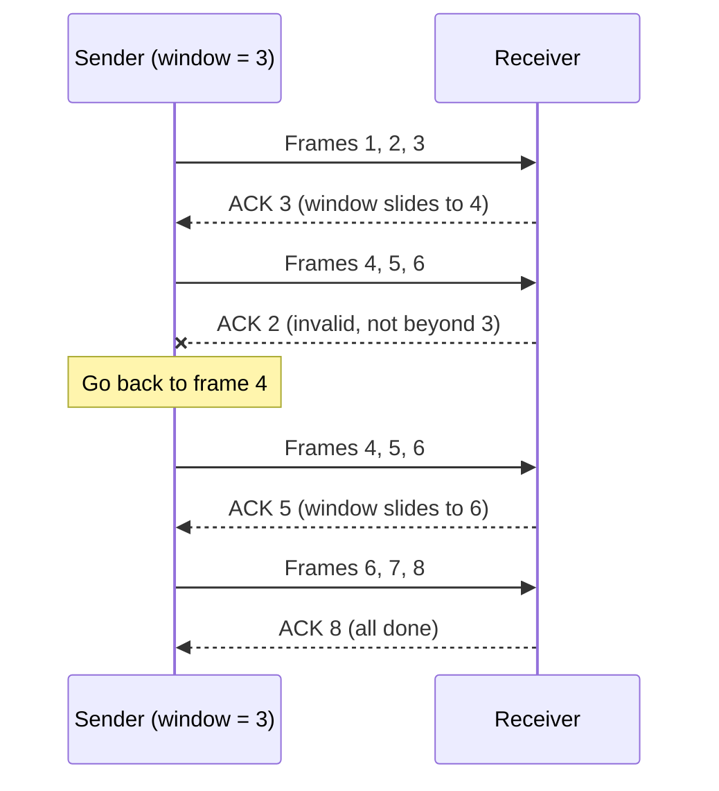
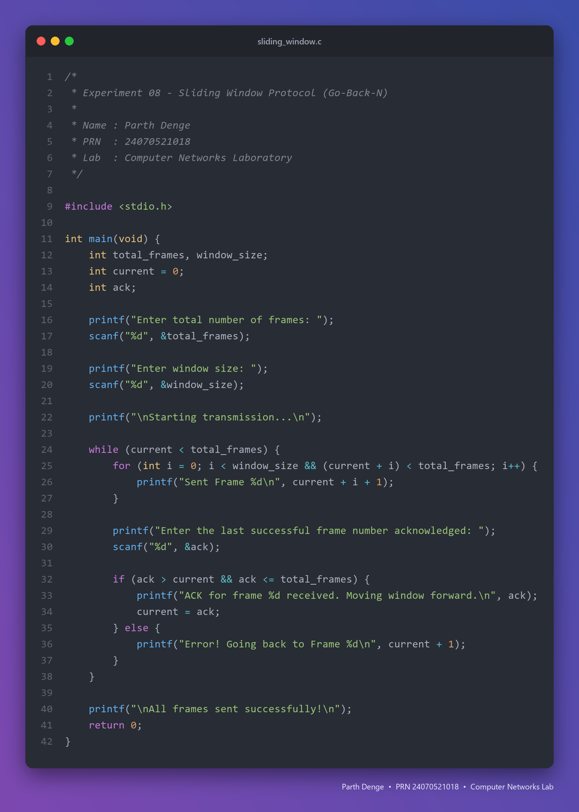
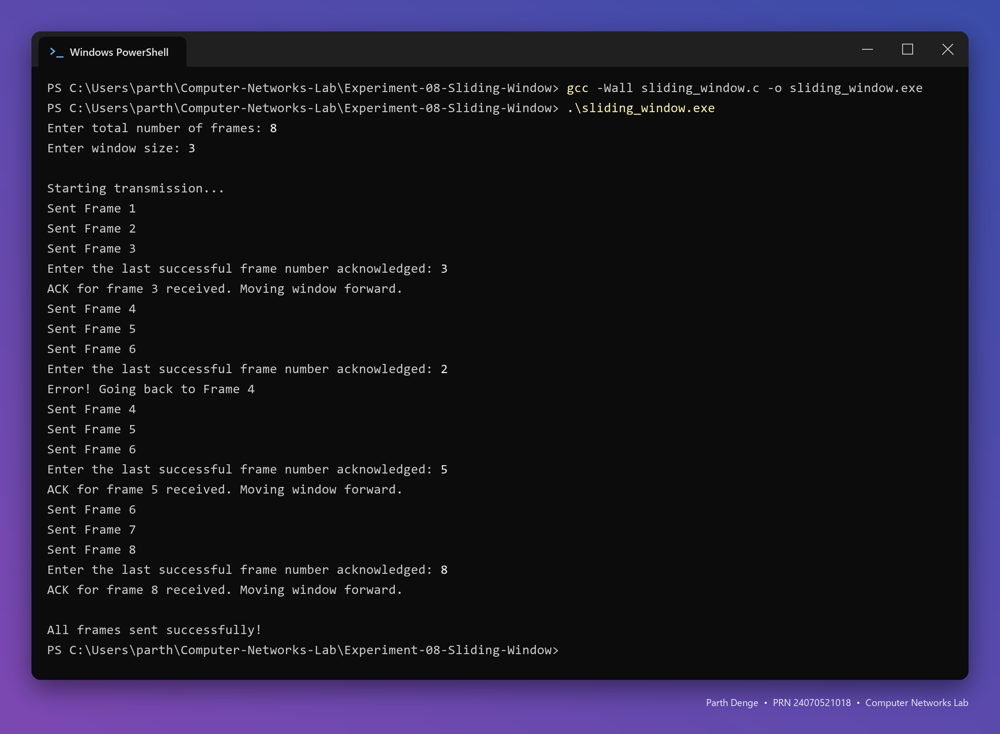

# Experiment 08: Sliding Window Protocol

**Name:** Parth Denge  **PRN:** 24070521018

## 1. Aim
To simulate the **Sliding Window** flow-control protocol with **Go-Back-N** retransmission in C: send a window of frames, slide the window on a valid cumulative acknowledgement and go back to the first unacknowledged frame on an error.

## 2. Theory
- **Stop-and-Wait** sends one frame and waits for its ACK, which wastes the link when the delay is long.
- **Sliding Window** lets the sender have up to **N** (window size) unacknowledged frames in flight (pipelining).
- **Cumulative ACK k** means "all frames up to k arrived", so the window base moves to k + 1.
- **Go-Back-N:** if the ACK is missing or invalid, the sender resends **every frame from the first unacknowledged one**.



## 3. Algorithm
1. Read `total_frames` and `window_size`; set `current = 0` (window base).
2. While `current < total_frames`:
   - send frames `current + 1` up to `current + window_size` (not past `total_frames`);
   - read the last acknowledged frame `ack`;
   - if `current < ack <= total_frames`, slide the window: `current = ack`;
   - otherwise print an error and resend from `current + 1`.
3. Print `All frames sent successfully!`.

## 4. Program
Source: [`sliding_window.c`](sliding_window.c)



## 5. How to Run
```bash
gcc sliding_window.c -o sliding_window && ./sliding_window
```

## 6. Output
Input: **8 frames, window size 3**, ACKs typed: `3`, `2` (error), `5` (partial), `8`.



### Observations
| ACK typed | Effect |
|---|---|
| 3 | valid, window slides; frames 4–6 sent |
| 2 | not beyond the base (3), so error: **go back to frame 4**, frames 4–6 resent |
| 5 | partial cumulative ACK; window slides to 6, frames 6–8 sent (frame 6 is sent again) |
| 8 | all frames acknowledged; transmission complete |

## 7. Result
The Sliding Window protocol with Go-Back-N was simulated in C. It showed pipelined transmission within the window, window sliding on cumulative ACKs (including a partial ACK) and retransmission of the whole outstanding window after an error.
