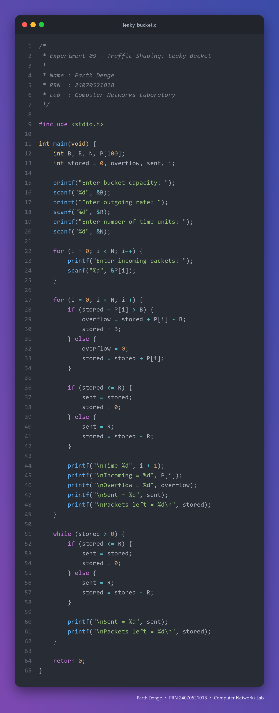
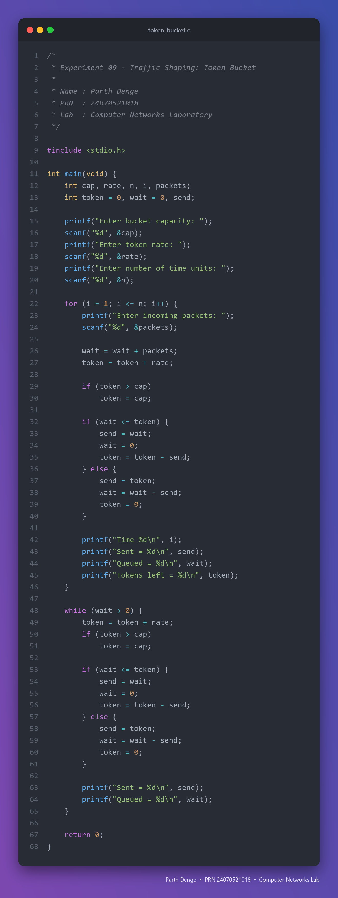
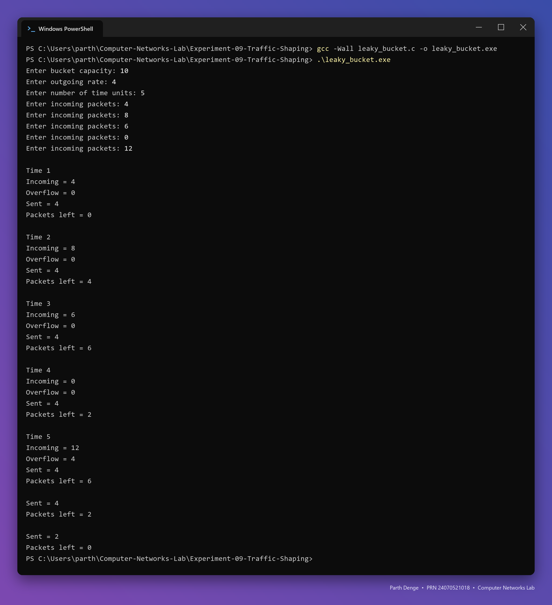
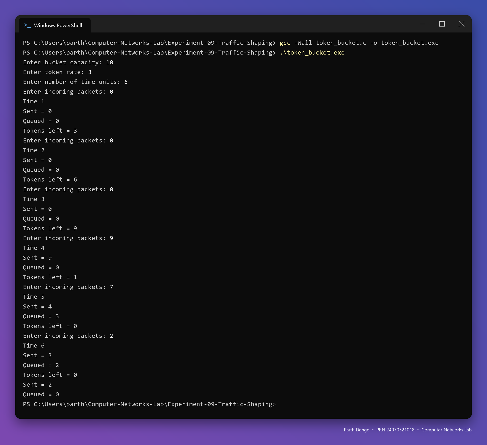

# Experiment 09: Traffic Shaping: Leaky Bucket and Token Bucket

**Name:** Parth Denge  **PRN:** 24070521018

## 1. Aim
To implement and compare the **Leaky Bucket** and **Token Bucket** traffic-shaping algorithms in C.

## 2. Theory
Traffic shaping controls the **rate** at which packets enter the network, so bursts do not cause congestion.

| | Leaky Bucket | Token Bucket |
|---|---|---|
| Idea | packets drip out of a bucket at a **fixed rate R** | tokens are added at rate **r**; sending a packet costs one token |
| Output | perfectly smooth, constant rate | average rate r, but **bursts allowed** up to the saved tokens |
| When full | extra packets **overflow (dropped)** | extra tokens are discarded; packets wait in a queue |
| Idle periods | nothing is saved | tokens accumulate (up to the capacity) |

## 3. Algorithms

**Leaky Bucket** (capacity B, output rate R)
1. Each time unit add the incoming packets; anything above B is **overflow** (dropped) and the bucket is capped at B.
2. Send `min(stored, R)` packets; the rest stay in the bucket.
3. After the input ends, keep sending R per step until the bucket is empty.

**Token Bucket** (capacity cap, token rate r)
1. Each time unit add incoming packets to the queue and r tokens to the bucket (capped at cap).
2. Send `min(queue, tokens)` packets and subtract the tokens used.
3. After the input ends, keep adding tokens and sending until the queue is empty.

## 4. Programs
Sources: [`leaky_bucket.c`](leaky_bucket.c), [`token_bucket.c`](token_bucket.c)





## 5. How to Run
```bash
gcc leaky_bucket.c -o leaky_bucket && ./leaky_bucket
gcc token_bucket.c -o token_bucket && ./token_bucket
```

## 6. Output

### Leaky Bucket: capacity 10, rate 4, incoming 4, 8, 6, 0, 12



| Time | Incoming | Overflow | Sent | Left in bucket |
|:-:|:-:|:-:|:-:|:-:|
| 1 | 4 | 0 | 4 | 0 |
| 2 | 8 | 0 | 4 | 4 |
| 3 | 6 | 0 | 4 | 6 |
| 4 | 0 | 0 | 4 | 2 |
| 5 | 12 | **4** | 4 | 6 |
| drain | – | – | 4, 2 | 2, 0 |

### Token Bucket: capacity 10, rate 3, incoming 0, 0, 0, 9, 7, 2



| Time | Incoming | Sent | Queued | Tokens left |
|:-:|:-:|:-:|:-:|:-:|
| 1 | 0 | 0 | 0 | 3 |
| 2 | 0 | 0 | 0 | 6 |
| 3 | 0 | 0 | 0 | 9 |
| 4 | 9 | **9** | 0 | 1 |
| 5 | 7 | 4 | 3 | 0 |
| 6 | 2 | 3 | 2 | 0 |
| drain | – | 2 | 0 | – |

### Observations
- The leaky bucket never sent more than **4 per step**, whatever arrived. At time 5 the burst of 12 did not fit, so **4 packets overflowed** and were lost.
- The token bucket saved 9 tokens during three idle steps and then sent a **burst of 9** at once, three times the token rate. After that the output fell back to the token rate and packets waited in the queue instead of being dropped.

## 7. Result
Both algorithms were implemented in C. The leaky bucket enforced a strict constant output rate and dropped the excess, while the token bucket kept the same long-term rate but allowed bursts up to the number of saved tokens.
