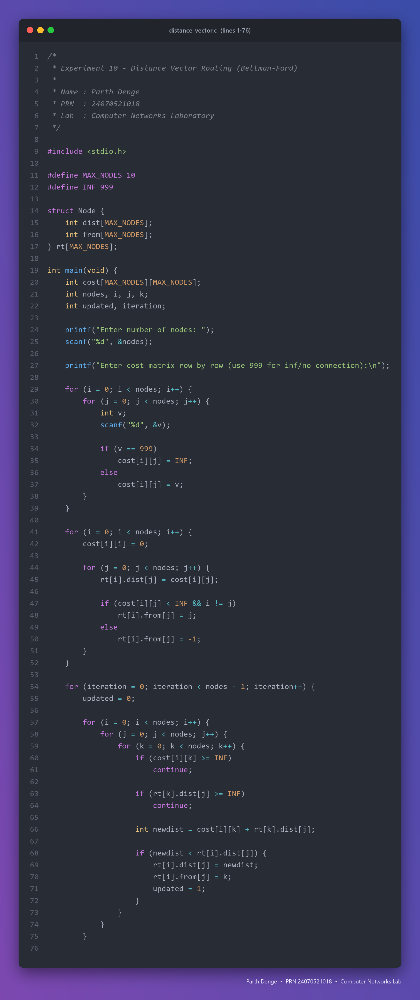
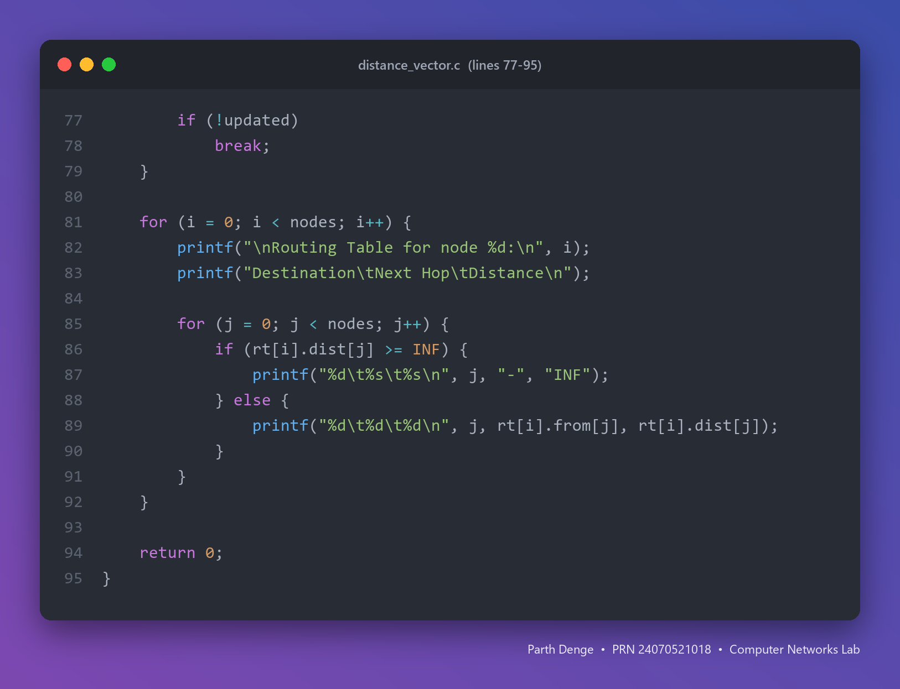
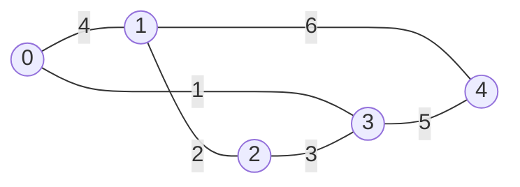
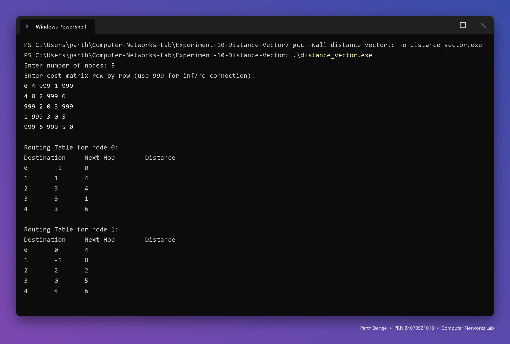
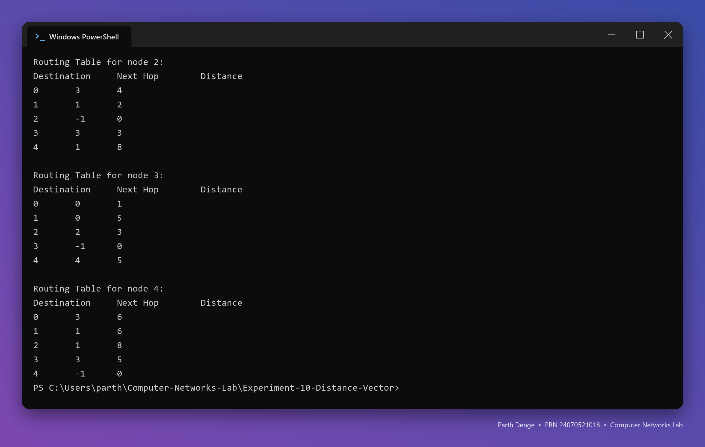

# Experiment 10: Distance Vector Routing

**Name:** Parth Denge  **PRN:** 24070521018

## 1. Aim
To implement the **Distance Vector Routing** algorithm (Bellman-Ford) in C and build the routing table (destination, next hop, distance) of every node from a link-cost matrix.

## 2. Theory
In distance vector routing (e.g. RIP), every router keeps a table of the **best known distance** to each destination and the **next hop** to use. Routers share these vectors with their neighbours and update them using the **Bellman-Ford equation**:

```text
D_x(y) = min over neighbours v of { c(x, v) + D_v(y) }
```

The tables are repeated until nothing changes (**convergence**), at most `N − 1` rounds for N nodes. A known weakness is the *count-to-infinity* problem when a link fails, which split horizon and poison reverse help to avoid.

## 3. Algorithm
1. Read the number of nodes and the N × N cost matrix (`999` = no direct link).
2. Initialise each node's table from the matrix: `dist[i][j] = cost[i][j]`, next hop `j` for direct links.
3. Repeat up to N − 1 times: for every node i, destination j and neighbour k, if `cost[i][k] + dist[k][j] < dist[i][j]`, update the distance and set the next hop to k. Stop early when no table changes.
4. Print the routing table of every node.

## 4. Program
Source: [`distance_vector.c`](distance_vector.c)





## 5. How to Run
```bash
gcc distance_vector.c -o distance_vector && ./distance_vector
```

## 6. Input Network (5 nodes)



```text
0   4   999 1   999
4   0   2   999 6
999 2   0   3   999
1   999 3   0   5
999 6   999 5   0
```

## 7. Output





### Converged routing tables (next hop / distance)

| From \ To | 0 | 1 | 2 | 3 | 4 |
|:-:|:-:|:-:|:-:|:-:|:-:|
| **0** | – / 0 | 1 / 4 | 3 / 4 | 3 / 1 | 3 / 6 |
| **1** | 0 / 4 | – / 0 | 2 / 2 | 0 / 5 | 4 / 6 |
| **2** | 3 / 4 | 1 / 2 | – / 0 | 3 / 3 | 1 / 8 |
| **3** | 0 / 1 | 0 / 5 | 2 / 3 | – / 0 | 4 / 5 |
| **4** | 3 / 6 | 1 / 6 | 1 / 8 | 3 / 5 | – / 0 |

### Observations
- Node 0 has **no direct link to node 2**, yet it learned the route **0 → 3 → 2 with cost 4** through its neighbour 3.
- Node 0 reaches node 4 through node 3 (1 + 5 = **6**) rather than through node 1 (4 + 6 = 10).
- Node 1 → 3 has two equal-cost paths (via 0: 4 + 1, via 2: 2 + 3, both 5); the program keeps the first one it finds (via 0).
- The tables are symmetric in distance (e.g. 2 → 4 and 4 → 2 are both 8), as expected for an undirected network.

## 8. Result
Distance Vector Routing was implemented in C using the Bellman-Ford equation. Every node computed the shortest distance and the correct next hop to all other nodes, including nodes it has no direct link to, and the tables converged within N − 1 iterations.
