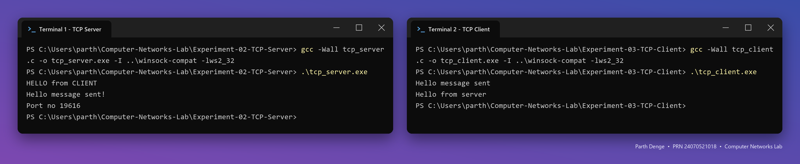
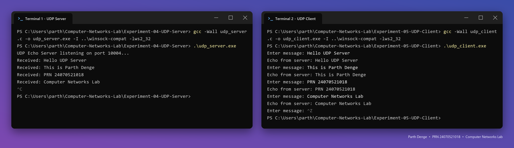
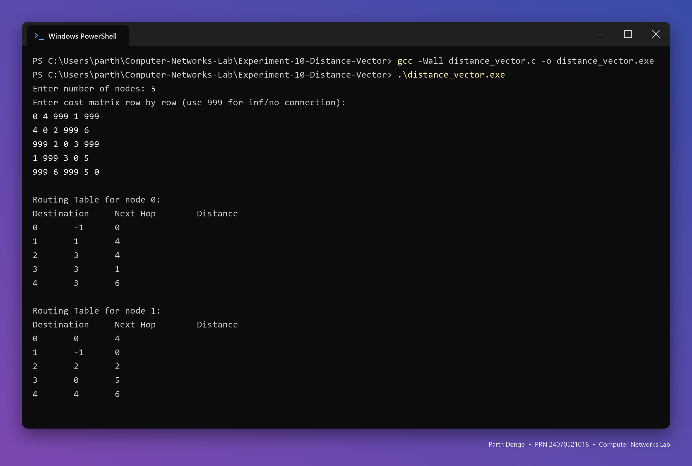
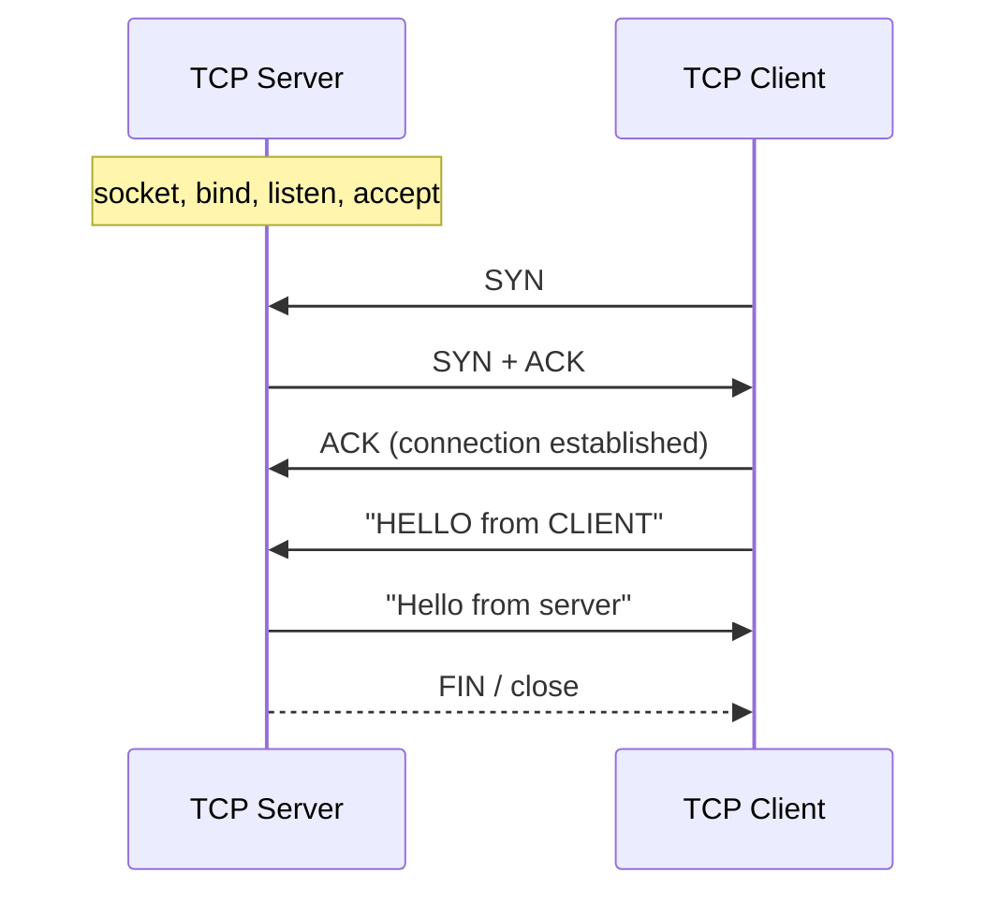
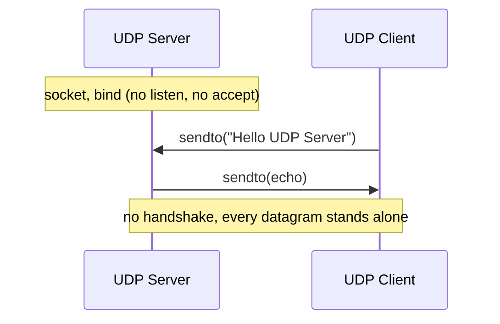

<div align="center">

# 🌐 Computer Networks Laboratory

**Socket programming · DNS & ICMP diagnostics · Packet analysis · Flow control · Traffic shaping · Routing**

<p>
  
  
  
  
</p>

</div>

---

## 👨‍💻 Author

|              |                               |
| ------------ | ----------------------------- |
| **Name**     | **Parth Denge**               |
| **PRN**      | **24070521018**               |
| **Course**   | **Computer Networks Laboratory** |

---

## 📚 Practicals

| No. | Experiment | Source | Screenshots | Documentation |
| :-: | ---------- | ------ | :---------: | :-----------: |
| **01** | Basic Networking Elements and Devices | — (`ipconfig`, `arp`, `route`) | [3](Experiment-01-Basic-Networking/screenshots) | [README](Experiment-01-Basic-Networking/README.md) |
| **02** | TCP Server Socket Programming | [`tcp_server.c`](Experiment-02-TCP-Server/tcp_server.c) | [3](Experiment-02-TCP-Server/screenshots) | [README](Experiment-02-TCP-Server/README.md) |
| **03** | TCP Client Socket Programming | [`tcp_client.c`](Experiment-03-TCP-Client/tcp_client.c) | [3](Experiment-03-TCP-Client/screenshots) | [README](Experiment-03-TCP-Client/README.md) |
| **04** | UDP Server Socket Programming | [`udp_server.c`](Experiment-04-UDP-Server/udp_server.c) | [3](Experiment-04-UDP-Server/screenshots) | [README](Experiment-04-UDP-Server/README.md) |
| **05** | UDP Client Socket Programming | [`udp_client.c`](Experiment-05-UDP-Client/udp_client.c) | [3](Experiment-05-UDP-Client/screenshots) | [README](Experiment-05-UDP-Client/README.md) |
| **06** | DNS Commands Using the Terminal | — (`nslookup`, `ping`, `tracert`, `ipconfig`) | [6](Experiment-06-DNS-Commands/screenshots) | [README](Experiment-06-DNS-Commands/README.md) |
| **07** | DNS and HTTP / HTTPS Packet Analysis | [`packet_dissector.py`](Experiment-07-Wireshark-Analysis/packet_dissector.py) | [7](Experiment-07-Wireshark-Analysis/screenshots) | [README](Experiment-07-Wireshark-Analysis/README.md) |
| **08** | Sliding Window Protocol (Go-Back-N) | [`sliding_window.c`](Experiment-08-Sliding-Window/sliding_window.c) | [2](Experiment-08-Sliding-Window/screenshots) | [README](Experiment-08-Sliding-Window/README.md) |
| **09** | Traffic Shaping: Leaky Bucket & Token Bucket | [`leaky_bucket.c`](Experiment-09-Traffic-Shaping/leaky_bucket.c), [`token_bucket.c`](Experiment-09-Traffic-Shaping/token_bucket.c) | [4](Experiment-09-Traffic-Shaping/screenshots) | [README](Experiment-09-Traffic-Shaping/README.md) |
| **10** | Distance Vector Routing (Bellman-Ford) | [`distance_vector.c`](Experiment-10-Distance-Vector/distance_vector.c) | [4](Experiment-10-Distance-Vector/screenshots) | [README](Experiment-10-Distance-Vector/README.md) |

Every experiment folder holds the **source code**, a **README** (aim, theory, algorithm, how to run, observations, result) and a **`screenshots/`** folder with the **code screenshots** and **output screenshots** of that practical.

---

## 📸 Preview

**TCP server and client talking over the loopback interface (Experiments 02 + 03)**



**UDP echo server and client (Experiments 04 + 05)**



**Distance vector routing tables (Experiment 10)**



---

## 📂 Repository Structure

```text
Computer-Networks-Lab/
├── README.md
├── winsock-compat/                    # lets the POSIX socket code build on Windows (MinGW)
├── Experiment-01-Basic-Networking/    README.md, screenshots/
├── Experiment-02-TCP-Server/          tcp_server.c, README.md, screenshots/
├── Experiment-03-TCP-Client/          tcp_client.c, README.md, screenshots/
├── Experiment-04-UDP-Server/          udp_server.c, README.md, screenshots/
├── Experiment-05-UDP-Client/          udp_client.c, README.md, screenshots/
├── Experiment-06-DNS-Commands/        README.md, screenshots/
├── Experiment-07-Wireshark-Analysis/  packet_dissector.py, README.md, screenshots/
├── Experiment-08-Sliding-Window/      sliding_window.c, README.md, screenshots/
├── Experiment-09-Traffic-Shaping/     leaky_bucket.c, token_bucket.c, README.md, screenshots/
└── Experiment-10-Distance-Vector/     distance_vector.c, README.md, screenshots/
```

---

## ▶️ Running the Programs

### Linux / WSL / macOS

```bash
gcc tcp_server.c -o tcp_server && ./tcp_server        # terminal 1
gcc tcp_client.c -o tcp_client && ./tcp_client        # terminal 2
```

### Windows (MinGW gcc, PowerShell)

The socket programs use the standard POSIX headers (`<sys/socket.h>`, `<netinet/in.h>`, `<arpa/inet.h>`).
On Windows, point gcc at the small [`winsock-compat`](winsock-compat) folder and link Winsock. **The experiment code is not changed.**

```powershell
gcc -Wall tcp_server.c -o tcp_server.exe -I ..\winsock-compat -lws2_32
.\tcp_server.exe
```

The simulations (Experiments 08 – 10) are plain C and build anywhere:

```powershell
gcc -Wall sliding_window.c -o sliding_window.exe
.\sliding_window.exe
```

Socket pairs: **start the server first**, then the client in a second terminal. TCP uses port **8080**, UDP uses port **10004**, both on `127.0.0.1`.

---

## 🖥️ How the Screenshots Were Made

All outputs were produced on **Windows 11** with **MinGW gcc 6.3** and **Python 3.13**:

* every program was compiled with `gcc -Wall` (no warnings) and actually run; the output screenshots show the real compile command, the real program output and the values typed in;
* socket experiments were run as two real processes (server + client) talking over `127.0.0.1`;
* the DNS / ICMP commands of Experiment 06 were run live, and in Experiment 01 the MAC addresses are partly masked (`XX`) for privacy;
* code screenshots are rendered directly from the source files in this repository, so they always match the code.

---

## 🔎 Concept Coverage

| Concept | Experiment |
| ------- | :--------: |
| Network devices, OSI layers, collision vs broadcast domains | 01 |
| TCP stream sockets, `socket → bind → listen → accept` | 02, 03 |
| UDP datagram sockets, `sendto / recvfrom` | 04, 05 |
| Forward / reverse DNS, MX and NS records | 06 |
| ICMP echo (`ping`) and TTL-based route tracing (`tracert`) | 06 |
| DNS message format, HTTP in plaintext vs HTTPS / TLS 1.3 | 07 |
| Flow control: Sliding Window, Go-Back-N | 08 |
| Traffic shaping: Leaky Bucket, Token Bucket | 09 |
| Distance Vector routing, Bellman-Ford equation | 10 |

### TCP vs UDP





---

<div align="center">

**Parth Denge** · PRN 24070521018 · Computer Networks Laboratory

</div>
